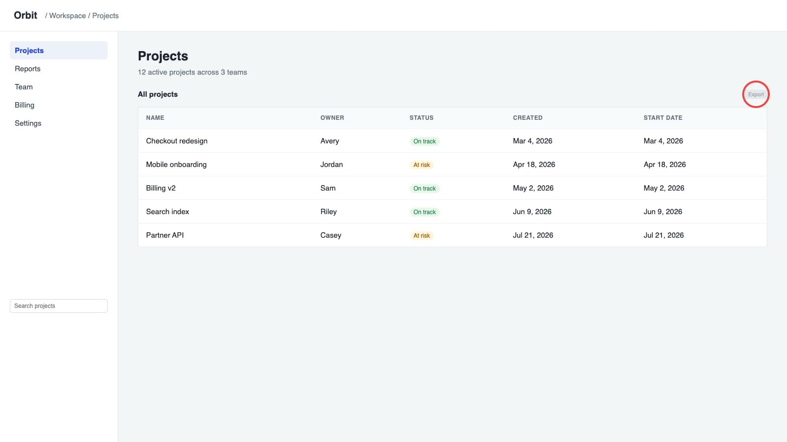
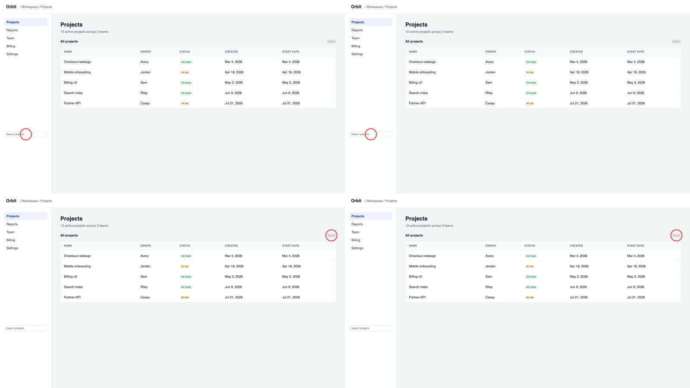
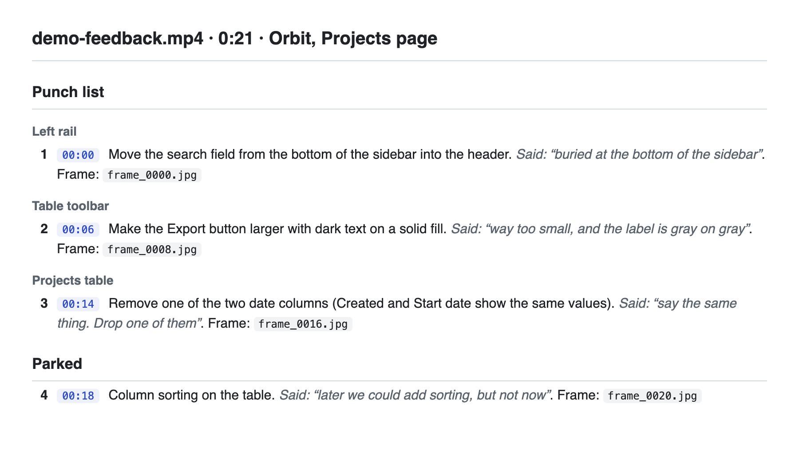

# video-notes

TL;DR: record your screen while you talk through what is wrong, hand the file to Claude Code, and get back a numbered punch list with a timestamp and a screenshot on every item. Transcription and frame grabs run locally with Whisper and ffmpeg.

## Why

Talking through a UI is faster than writing tickets, but a 5 minute video is hard for an agent to act on, and sending whole videos to a large model is slow and costly. This skill turns the recording into text plus a handful of stills first, so the model only reads what matters.

## What you get

Next to `feedback.mov`:

- `feedback.notes/transcript.md`: one row per spoken segment, with its time and frame
- `feedback.notes/frame_mmss.jpg`: a still taken just after each segment starts
- `feedback.notes.md`: the punch list, grouped by screen region, numbered across the whole list so you can reply "3 and 7"

## Example

A 21 second narrated recording of a sample app, run through the skill. Every image below is real output; [docs/demo](docs/demo) rebuilds it.

**1. The recording.** You talk while you point. Here: "This export button is way too small, and the label is gray on gray."



**2. Contact sheet** (`--sheet`). Four stills per image, so the model skims the whole video in a couple of reads before opening single frames.



**3. The punch list** (`demo-feedback.notes.md`). Grouped by screen region in the order you visited them, numbered across the whole list, with "later" items parked. [Source](docs/demo/demo-feedback.notes.md).



## Install

Requirements: Python 3.9+, `ffmpeg` and the Whisper CLI.

```bash
brew install ffmpeg
```

```bash
pip install openai-whisper
```

Then, in Claude Code:

```
/plugin marketplace add weeeha/video-notes
```

```
/plugin install video-notes@video-notes
```

Or copy `skills/video-notes` into `~/.claude/skills/`.

## Use

Say "I left feedback as a video" and paste the file path. To run the helper on its own:

```bash
python3 skills/video-notes/video-notes.py path/to/feedback.mov --sheet
```

| Flag | Effect |
|---|---|
| `--model turbo` | Bigger Whisper model when the default `base.en` transcript is garbled |
| `--every 10` | Extra frame every 10 seconds, for demos with no narration |
| `--sheet` | 2x2 contact sheets for a cheap first skim |
| `--max-frames 40` | Cap on stills (default 40) |
| `--width 2400` | Larger stills when small text must be read |
| `--force` | Rebuild even when the notes are newer than the video |

An existing `<video>.srt` next to the file is reused instead of transcribing.

## Known limits

- Whisper segments are merged into rows of up to 25 seconds, and a frame is taken at the start of each row. A short clip with steady talking can become one row with one frame; add `--every 4` to get a still every few seconds.
- The time labels on contact-sheet tiles need an ffmpeg built with the `drawtext` filter (some builds lack it; check with `ffmpeg -filters | grep drawtext`). Without it the sheet is still made, just unlabelled; tiles run left to right, top to bottom.

## Privacy

Audio is transcribed on your machine. The stills and transcript are read by whatever model your Claude Code session runs, the same as any file you open in it. Keep the `.notes/` folder out of git (`.git/info/exclude`) when the video sits inside a repo.

## License

MIT
